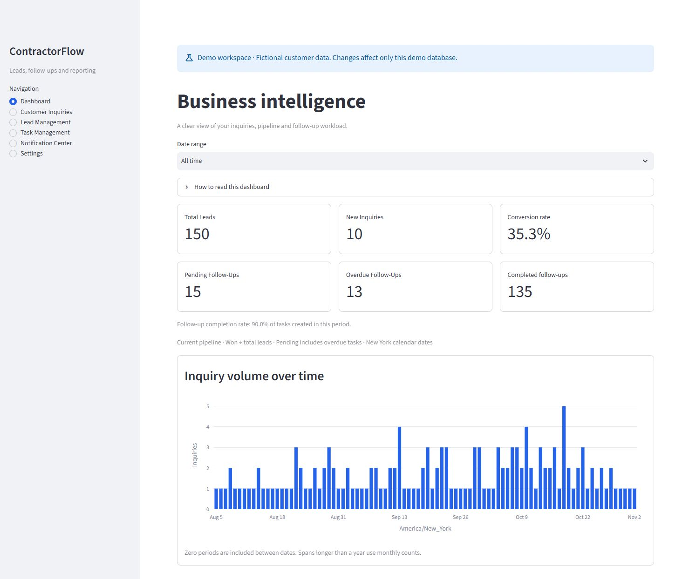
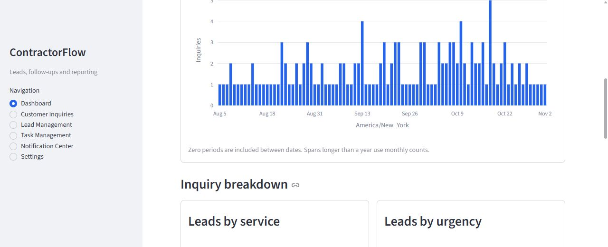
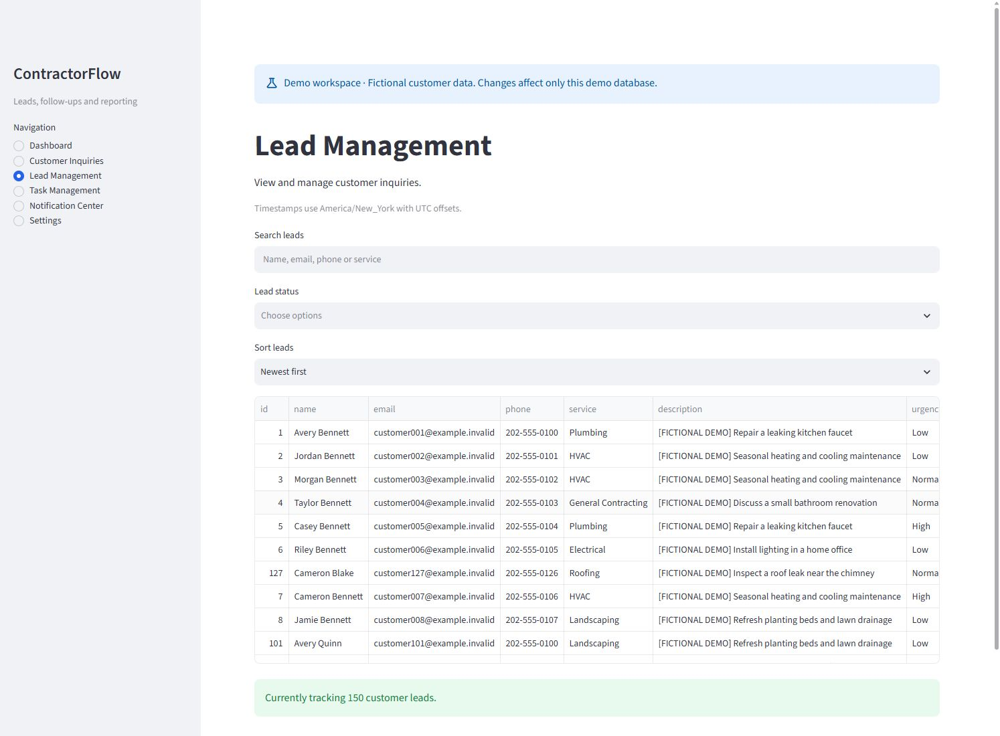
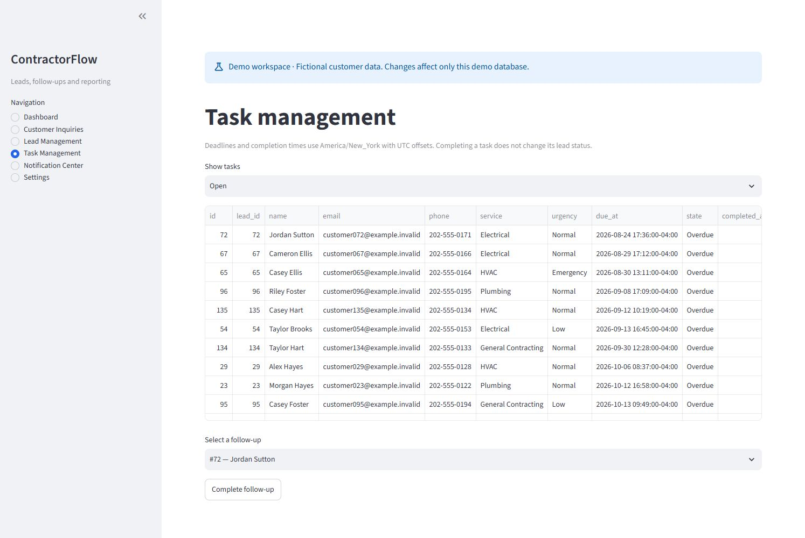
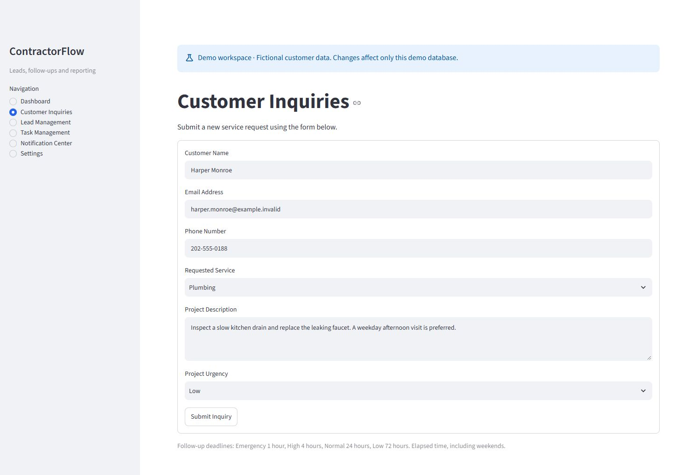
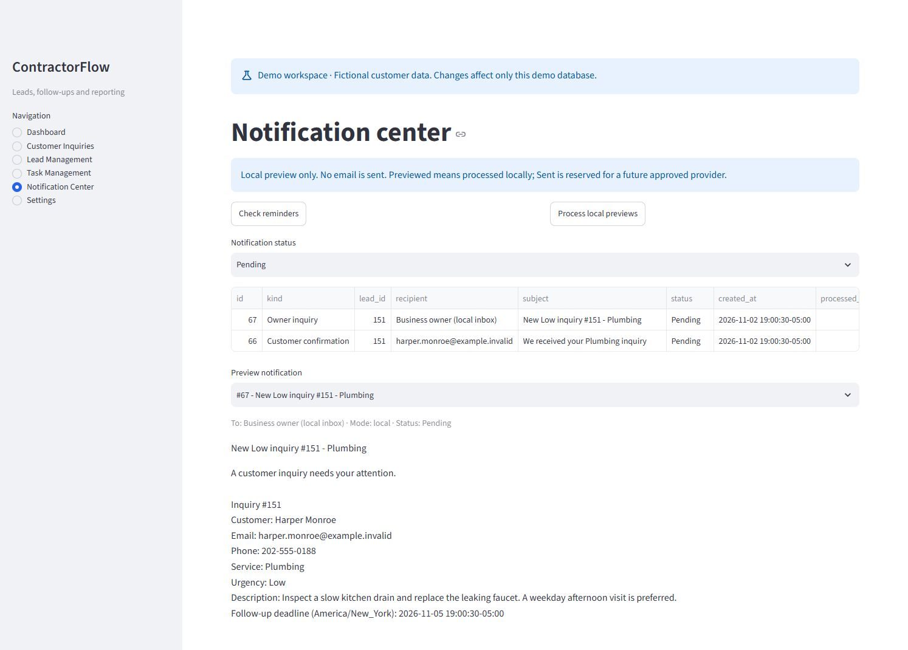

# ContractorFlow

ContractorFlow is a local CRM and workflow application for small contractors. It combines customer intake, lead management, follow-up tasks, operational reporting, and a persistent notification outbox.

Built with Python 3.14, Streamlit, Plotly, pandas, and SQLite. No paid service or email account is required. Notifications are local previews; external delivery is disabled.



All screenshots use isolated fictional demo data. View the [portfolio gallery and finalized repository metadata](docs/github-portfolio.md).

<details>
<summary>View all portfolio screenshots</summary>

### Service demand and urgency



### Lead management



### Follow-up tasks



### Customer intake



### Notification Center



</details>

## Features

- Validated customer inquiries and persistent submission keys to prevent repeated form submissions.
- Searchable lead records with status filters, sorting, and New / Contacted / Quoted / Won / Lost lifecycle states.
- Transactional follow-up creation: Emergency 1 hour, High 4 hours, Normal 24 hours, Low 72 hours.
- Pending, overdue, and completed task views with completion timestamps.
- Six dashboard KPIs, follow-up completion rate, service/urgency/status charts, pipeline reporting, and inquiry volume.
- New York calendar filters, UTC storage, and CSV reports with spreadsheet formula escaping.
- Customer confirmations, owner notifications, and upcoming/overdue reminders in a durable local outbox.
- A separate 150-inquiry fictional dataset for demonstrations.

## Installation

From the project directory on Windows:

```powershell
python -m venv .venv
.venv\Scripts\python -m pip install -r requirements-lock.txt
.venv\Scripts\python -m streamlit run main.py
```

Open the localhost address printed by Streamlit. The project configuration binds the server to `127.0.0.1`, disables usage statistics, and hides detailed error traces. Do not override the network binding for genuine customer data.

`requirements.txt` lists direct runtime dependencies. `requirements-lock.txt` pins the runtime dependency graph validated on Windows with Python 3.14. Other platforms are not yet certified. Install developer tools with `requirements-dev.txt`.

## Demonstration

```powershell
.venv\Scripts\python demo.py seed
.venv\Scripts\python demo.py run
```

The launcher uses `demo_data/contractorflow-demo.db` at [127.0.0.1:8502](http://127.0.0.1:8502). If that database already exists, run only the second command. Every page identifies the workspace as fictional. The launcher changes the database only for its child process and always selects local notification previews.

For repeatable fixtures, supply a seed and snapshot time:

```powershell
.venv\Scripts\python demo.py seed --database demo_data/replay.db --seed 42 --as-of "2026-11-02T17:00:00Z"
.venv\Scripts\python demo.py run --database demo_data/replay.db
```

The generator creates 150 unique fictional customers, seven service categories, all urgency/status levels, and 150 related tasks across 90 New York calendar dates. Email addresses use `example.invalid`; telephone numbers use the fictional 555-0100–0199 range. Task deadlines follow the same policy as normal inquiries. The seed and snapshot are saved in `demo_metadata`.

Create a fresh demonstration without replacing the previous file:

```powershell
.venv\Scripts\python demo.py reset
```

Reset prints a launch command for a newly named database. Existing demo and operational files are retained. A demo snapshot uses the real clock when viewed: deadlines age and recent-date reports change over time. Generate a fresh snapshot near a presentation.

## Notifications

Submitting an inquiry saves its lead, follow-up task, two message snapshots, and optional submission key in one SQLite transaction. Customer messages confirm receipt without promising an appointment. Owner messages include contact details, service, urgency, and the local follow-up deadline. The owner recipient is a logical local inbox, not a configured email address.

The Notification Center supports status filtering, plain-text previews, local processing, and manual retry of failed rows. Statuses are Pending, Previewed, Failed, Cancelled, and reserved Sent. **Previewed does not mean sent.** This release never sets Sent and has no network delivery adapter.

Reminder checks run on application reruns and can also run from a scheduler:

```powershell
.venv\Scripts\python -m notifications check
.venv\Scripts\python -m notifications preview
```

The first command queues reminders; the second processes pending local previews. No scheduler is installed automatically. With the app closed, reminders require an external local scheduler to invoke the command. Upcoming means a deadline within 24 hours, including exactly now; overdue means earlier than now. Each task/deadline can produce one upcoming and one overdue notification. Unique database keys prevent duplicate checks from adding duplicate events. Completed tasks do not generate reminders; stale reminders are cancelled before processing. Failed rows require deliberate retry rather than retrying on every rerun.

`delivery.py` defines the provider boundary. `CONTRACTORFLOW_DELIVERY_MODE=local` is the only accepted mode outside demonstrations; demonstrations force local mode. Live delivery requires a future code change, administrator configuration, and explicit approval. No credentials are included or requested. See [notification design](docs/architecture.md).

## Reporting definitions

- Conversion rate: Won divided by all filtered leads; no leads displays N/A.
- New inquiries: filtered leads whose current status is New.
- Pending: every unfinished task, including overdue and unknown-deadline tasks.
- Overdue: unfinished tasks with a valid deadline earlier than now.
- Completion rate: completed tasks divided by tasks created in the selected period; empty cohorts display N/A.
- Last 7/30/90 days: New York midnight N−1 days ago through the current instant. Leads use submission dates; tasks independently use task creation dates.
- All time includes records with unknown dates; those records are flagged and excluded from the timeline. Finite windows exclude unknown/future creation dates.
- Pipeline stages are current independent counts, not historical transitions or a cumulative funnel. No revenue is inferred.

All timestamps remain UTC in SQLite. Original naive SQLite lead timestamps are interpreted as UTC. Displayed/exported timestamps use America/New_York with explicit offsets. Daily chart labels contain dates only; spans over 366 days use monthly bins.

Exports match the selected cohort, preserve empty headers, and use UTF-8 with a BOM. Formula-like text is prefixed with an apostrophe for spreadsheet safety, including phone numbers beginning with +. Reports contain contact information; handle them as private data.

## Storage and recovery

The default database is `contractorflow.db` beside the application. `CONTRACTORFLOW_DB_PATH` can select a different absolute path whose parent already exists. Environment configuration is read at startup; `.env.example` documents options, but `.env` files are not loaded automatically.

Initialization adds missing tables and indexes without rewriting customer/task records. Historical leads are not backfilled with tasks or confirmation messages. New reminders may be queued for existing unfinished tasks. See [schema and architecture](docs/architecture.md).

```powershell
.venv\Scripts\python backup.py create backups/manual-snapshot.db
.venv\Scripts\python backup.py recover backups/recovered.db --source backups/manual-snapshot.db
```

Create the destination directory first. Backup uses SQLite's snapshot API and validates integrity/foreign keys. Recovery writes a new file and refuses existing files and the active operational path. Inspect a recovered database and stop the app before selecting it with `CONTRACTORFLOW_DB_PATH`. Git exclusions are not a backup policy. Backups are unencrypted and need the same protection as customer records.

## Development

```powershell
.venv\Scripts\python -m pip install -r requirements-dev.txt
.venv\Scripts\python -m pytest --cov --cov-report=term-missing
.venv\Scripts\python -m ruff check .
.venv\Scripts\python -m ruff format --check .
.venv\Scripts\python -m mypy
.venv\Scripts\python -m pip_audit -r requirements-lock.txt
```

Tests use temporary databases. Coverage measures the business/storage/tooling modules; Streamlit workflows are verified separately with AppTest. Type checking currently covers configuration, delivery, and intake boundaries. CI runs these checks on Windows/Python 3.14; the [published main-branch workflow](https://github.com/jholbrook88/ContractorFlow/actions/workflows/ci.yml) has passed on GitHub.

## Security and project status

This is a local application, not an authenticated multi-tenant service. It does not implement user accounts, role permissions, encryption at rest, legal retention controls, or a production job worker. Do not expose an operational database publicly. The supported portfolio demonstration uses fictional data and local-only preview delivery.

Operational databases, demo files, backups, secrets, local IDE configuration, development instructions, and generated review artifacts are excluded from source control. Read [security limitations](SECURITY.md), [demo capture instructions](docs/demo-walkthrough.md), and the [publication review](docs/publication-readiness.md) before sharing the repository.

Developed by **Jason Holbrook**. Licensed under the [MIT License](LICENSE). Existing Git history and attribution are retained. See the [final publication checklist](docs/github-publication-checklist.md) before publishing.
