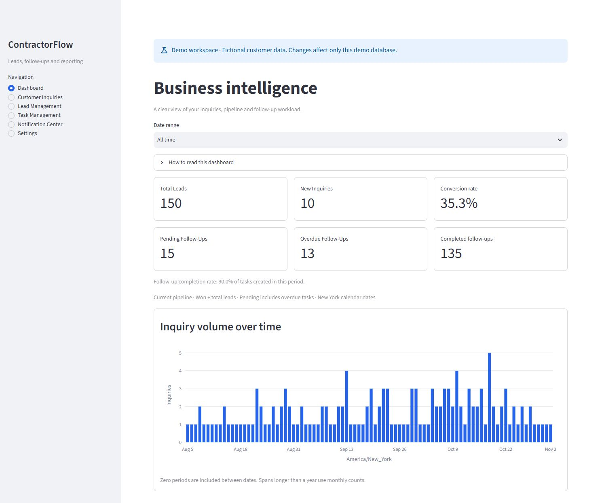
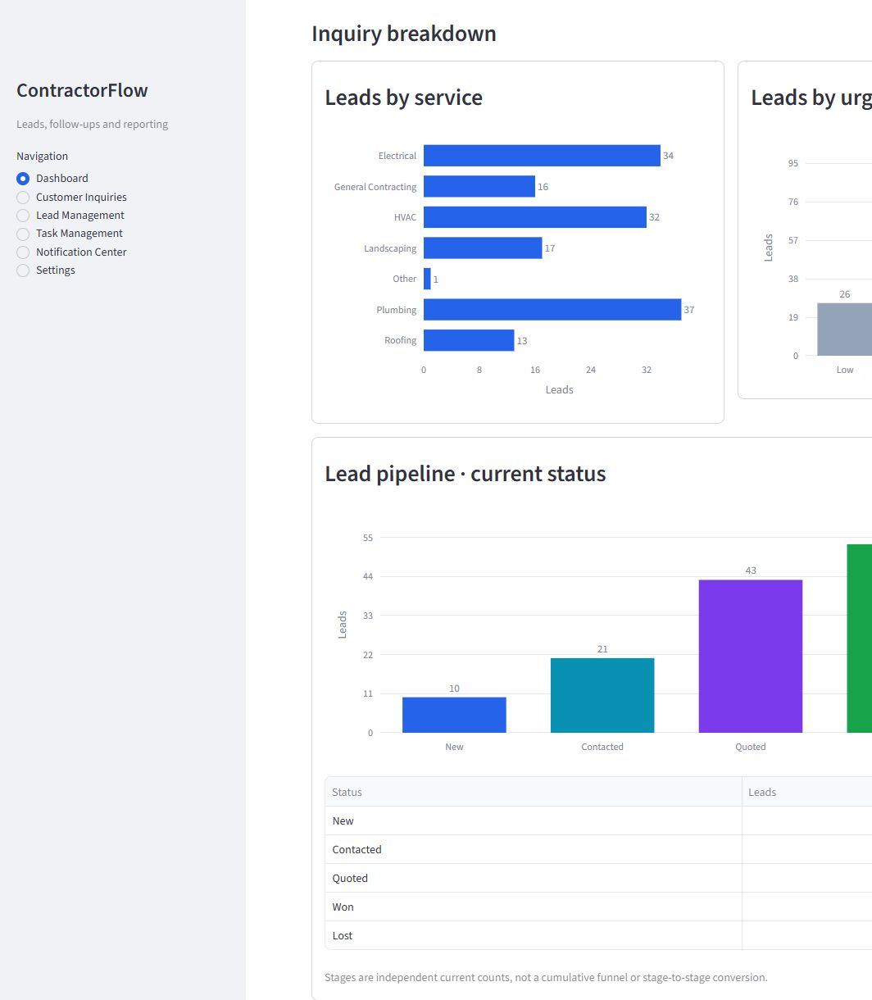
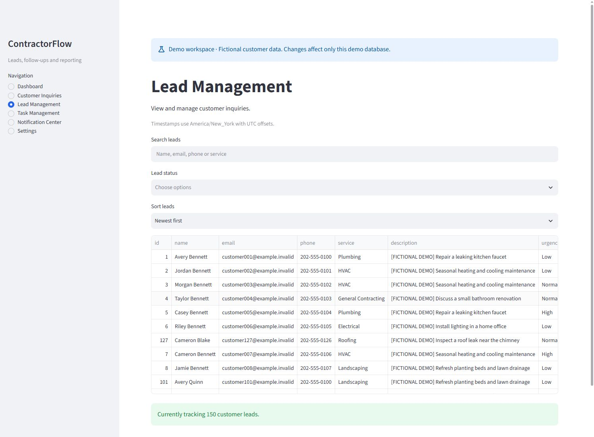
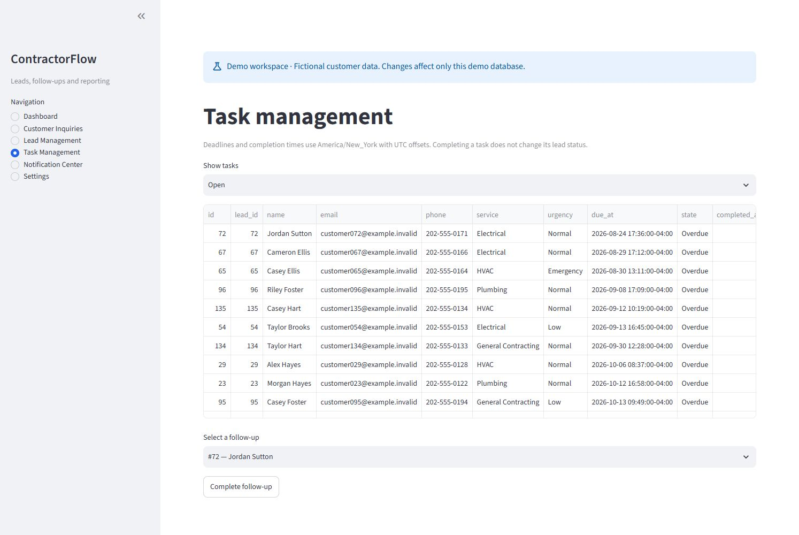
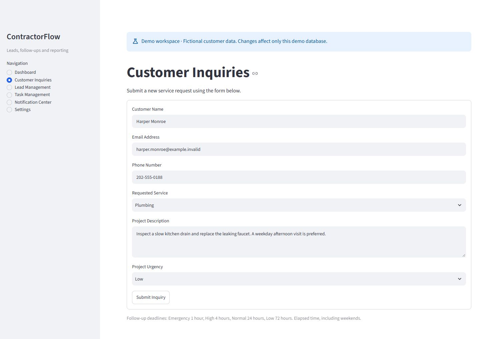
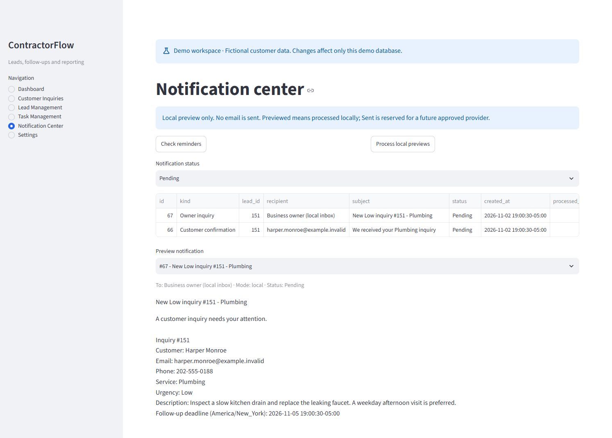

# GitHub portfolio

## Repository metadata

**Description**

A Python-based CRM and business automation platform for small contractors, featuring lead management, automated follow-ups, and business intelligence dashboards.

**Topics**

`python` · `streamlit` · `sqlite` · `plotly` · `crm` · `workflow-automation` · `business-intelligence` · `small-business`

The copy-ready values are also stored in [.github/repository-metadata.json](../.github/repository-metadata.json). This is a local publication reference, not an automatically applied GitHub configuration. Repository visibility, the security contact, and publication remain subject to owner approval.

## Screenshot gallery

Captured November 2, 2026 from a fresh, isolated demo using seed 42. These are real application screenshots from the clean in-app browser, without personal browser chrome or extensions. Every contact is fictional: addresses use example.invalid and telephone numbers use the reserved 555-0100–0199 range. None of the images uses the operational database. Workspace screenshots retain the demo banner; the analytics detail is a native crop with the same fictional data.

### Dashboard

Six KPIs and the date-only inquiry timeline for the 150-inquiry, 90-day fictional snapshot. The values describe generated data, not actual business results.

### Service demand, urgency and pipeline

The same 150 inquiries grouped by service, urgency and current lead status. Pipeline bars are independent counts, not a cumulative funnel.

### Lead management

Search, status filters and sorting above fictional customer records. The application supports independent lead status updates.

### Follow-up tasks

Open tasks include overdue work, local deadlines and the completion control. All contact details belong to the fictional fixture.

### Customer intake

A prepared fictional request for Harper Monroe, submitted only to this isolated local demo after this capture.

### Notification Center

The request creates inquiry 151 and two pending message snapshots. The owner preview includes the service, urgency and follow-up deadline; the customer confirmation appears in history. Earlier fictional reminders were processed locally. Pending messages remain previewable, and no real email was sent.

## Capture record

- Source code at capture: local commit b52395f; no application changes were made for the screenshots.
- Data: seed 42; 150 generated inquiries and tasks across 90 New York calendar dates; one additional fictional form submission for the notification view.
- Snapshot timestamp (UTC): `2026-11-02T23:58:17.000000+00:00`; retained in the ignored capture database metadata. Live task states use the real clock, so recreating images later can change date ranges and overdue counts.
- Files: original JPEG output from browser capture, with native rectangular cropping for focused framing. No EXIF metadata or personal account overlays.
- Privacy review: visible addresses, telephone numbers, names and project descriptions were reviewed against the fictional source. Operational storage was not used for capture.

To recreate, generate a fresh demo with `python demo.py reset`, launch the printed command, and follow [the walkthrough](demo-walkthrough.md). These images are prepared for the reviewed source candidate; they have not been uploaded or published.
